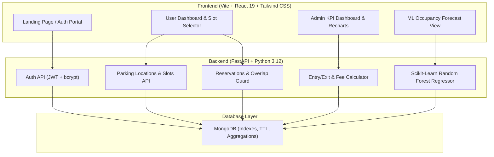

# Smart Parking Management System - Project Report

A full-stack, production-grade **Smart Parking Management System** featuring real-time parking slot tracking, conflict-free reservations, automatic entry/exit management, and a Scikit-Learn Machine Learning pipeline for 24-hour occupancy forecasting.

---

## 1. System Architecture & Tech Stack

| Layer | Technology | Key Capabilities |
| :--- | :--- | :--- |
| **Frontend** | React 19, Vite, Tailwind CSS | Responsive dark-mode UI, Lucide icons, glassmorphism cards, real-time slot grid |
| **Data Viz** | Recharts | Occupancy trend areas, revenue timelines, status distribution charts |
| **Backend** | Python 3.12, FastAPI, Uvicorn | Async REST APIs, CORS middleware, Pydantic validation |
| **Auth** | PyJWT, bcrypt | Role-Based Access Control (Admin & User roles), bearer token security |
| **Database** | MongoDB Atlas / Local MongoDB, PyMongo | Compound unique indexes on `(location_id, slot_number)`, conflict protection |
| **Machine Learning**| Scikit-learn, Pandas, NumPy | `RandomForestRegressor` with feature engineering for 24-hour peak occupancy prediction |

---

## 2. End-to-End Workflow Demonstration

---

## 3. Implemented Capabilities & Verified Pages

### User Features
- **Authentication**: JWT login and signup with client-side credential storage and automatic token refresh.
- **Find Parking**: Search locations by city or filter by indoor/outdoor type and hourly rate.
- **Interactive Slot Grid**: Visual color-coded slot map with designations for Standard, EV Charging (⚡), and Accessible (♿) parking.
- **Reservation Engine**: Real-time interval overlap validation preventing double bookings.
- **Vehicle Management**: Register and manage multiple vehicles with plate formatting.
- **Booking History**: Track active, completed, or cancelled bookings with breakdown of duration and hourly rates.

### Admin Features
- **Executive KPI Dashboard**: High-level telemetry for active vehicles, total revenue, spot occupancy, and fleet utilization.
- **Location & Slot Management**: Add, modify, or remove parking facilities and dynamically generate slot grids.
- **Entry & Exit Terminal**: One-click check-in and check-out tracking actual entry/exit timestamps and exact parking fee calculation.
- **Machine Learning Predictor**:
  - `RandomForestRegressor` trained on temporal parking logs.
  - Generates hourly occupancy forecasts for the next 24 hours.
  - Automatically flags peak morning (7–10 AM) and peak evening (4–7 PM) traffic windows.

---

## 4. Demo Credentials & Access Points

| Role | Email | Password | Primary Dashboard |
| :--- | :--- | :--- | :--- |
| **Admin** | `admin@smartparking.com` | `admin123` | [Admin Dashboard](http://localhost:5173/admin/dashboard) |
| **User** | `rahul@example.com` | `password123` | [User Dashboard](http://localhost:5173/dashboard) |

- **Frontend Application**: `http://localhost:5173`
- **Backend API Docs (Swagger)**: `http://localhost:8000/docs`
- **Backend Health Check**: `http://localhost:8000/health`
